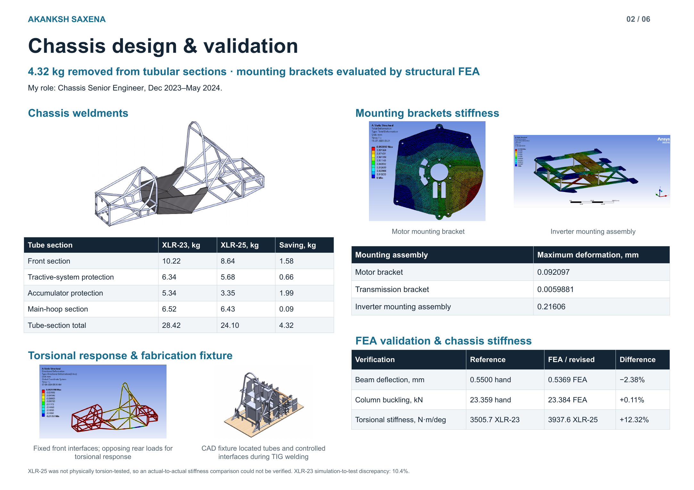
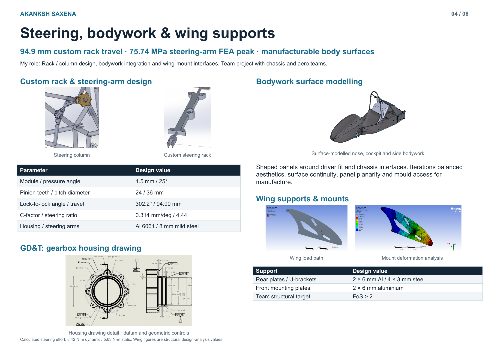
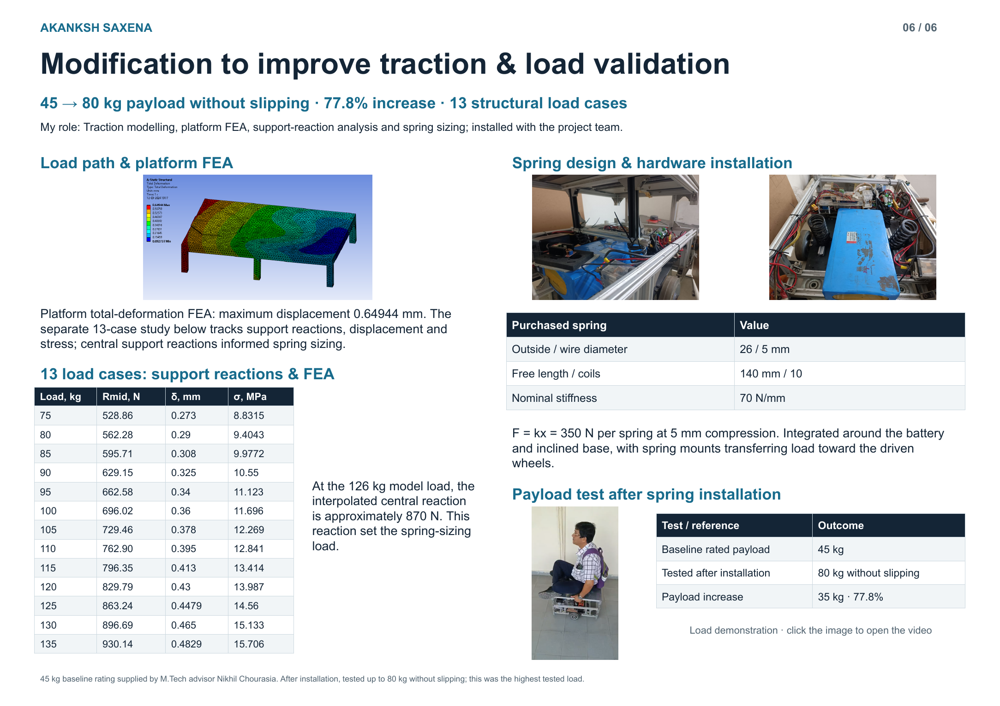

# Robotics & Mechanical Systems: Hardware Portfolio

[Download the PDF](assets/Akanksh_Portfolio.pdf)

---

[Watch the RoboMuse load demonstration video](https://drive.google.com/file/d/1cF3iOg6nELhrjTUlDZCdhCefdGjY1K6J/view)